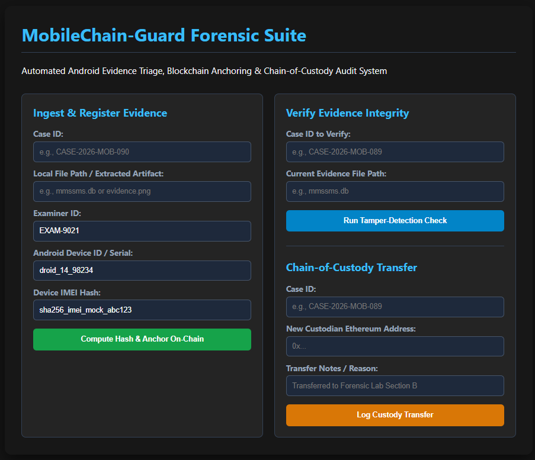
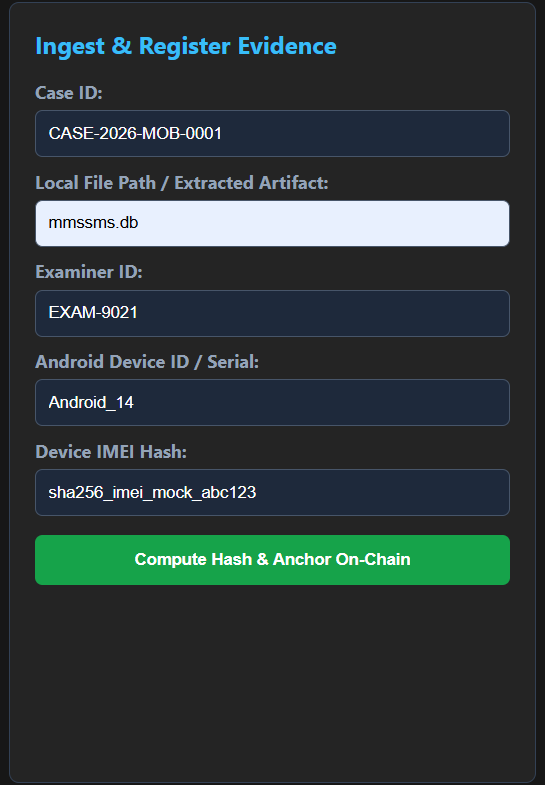
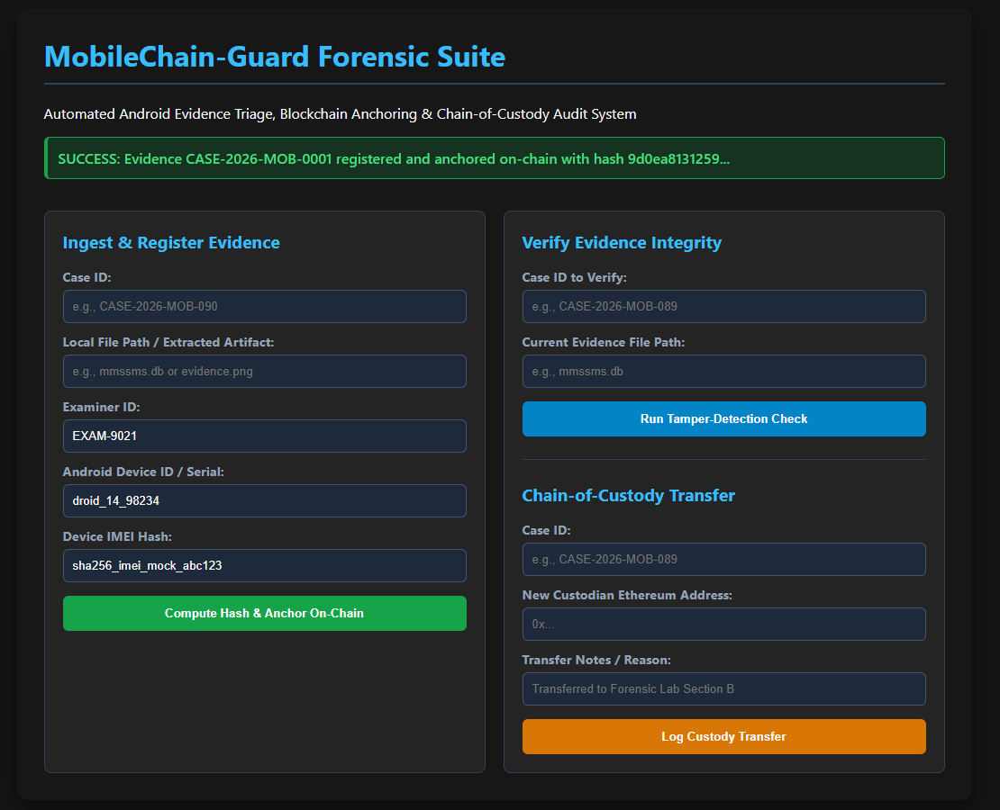
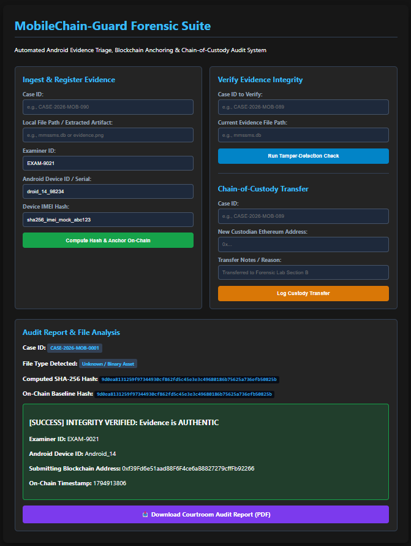
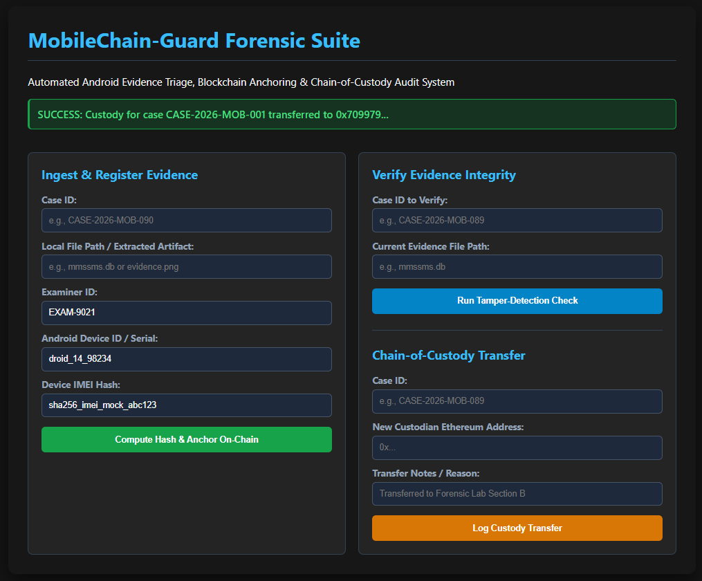
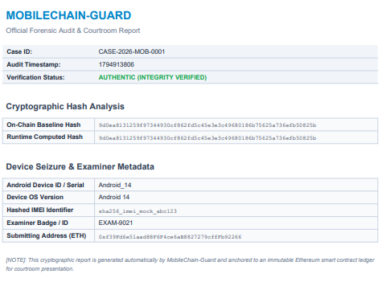
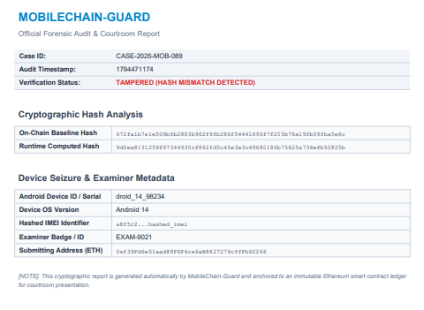

# 🛡️ MobileChain-Guard

Automated Android Evidence Triage, Blockchain Anchoring & Chain-of-Custody Audit System. Designed for secure digital forensics, immutable chain-of-custody tracking, and tamper-detection verification backed by Ethereum smart contracts.

---

## 🛠️ Tech Stack & Architecture
* **Backend:** Python, Flask, Web3.py
* **Smart Contract:** Solidity, Hardhat, Ethereum Local Node
* **Frontend:** HTML5, CSS3, JavaScript (Responsive Dashboard)
* **Forensics:** SHA-256 cryptographic hashing for evidence file integrity and metadata verification

---

##  System Walkthrough & UI Preview

Here is a quick visual tour of **MobileChain-Guard** in action:

| Feature / Interface | Description | Screenshot |
| :--- | :--- | :--- |
| **Main Dashboard** | Overview of the forensic suite interface for evidence handling and chain-of-custody. |  |
| **Evidence Ingestion** | Form input capturing Case ID, extracted artifact path, examiner ID, and device metadata. |  |
| **On-Chain Anchoring** | Successful cryptographic hashing and immutable registration on the Ethereum smart contract. |  |
| **Integrity Verification** | Real-time tamper-detection audit check confirming evidence authenticity against the ledger. |  |
| **Custody Transfer** | Secure on-chain hand-off logging the transfer of evidence custody to a new examiner address. |  |
| **Audit Report (Authentic)** | Official courtroom-ready forensic audit report verifying genuine file integrity. |  |
| **Audit Report (Tampered)** | Security alert triggered on the report when a hash mismatch or tampering is detected. |  |

---

##  Quick Start

1. **Start Hardhat Local Node:**
   ```bash
   npx hardhat node